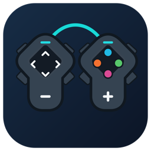

# ClickShift

ClickShift lets you shift gears in MyWhoosh with Zwift Click V2 controllers. It connects to the Clicks
over Bluetooth and shows up in MyWhoosh's Device Connection screen as a controller. MyWhoosh keeps
controlling the trainer; ClickShift only sends the button presses.

This repository holds the downloads and their instructions. Questions and bug reports are welcome in
[Issues](https://github.com/damcyk96/ClickShift-releases/issues).

## Download

Get the latest version from [Releases](https://github.com/damcyk96/ClickShift-releases/releases/latest):

| System | File | Requirements |
| --- | --- | --- |
| macOS | `ClickShift-macos.zip` | Apple Silicon Mac (M1 or later) with Bluetooth |
| Windows | `ClickShift-windows.zip` | Windows 10 (1809 or later) or Windows 11 with Bluetooth LE, and Apple Bonjour |

Both need MyWhoosh with **Virtual Shifting / MyShift** enabled, a trainer paired directly with MyWhoosh,
and Zwift Click V2 controllers. MyWhoosh can run on the same computer or on another device in the same
network.

ClickShift is experimental. The macOS app has been used with two Click V2 controllers and a Wahoo KICKR V6;
the Windows app is a first version.

## Install

### macOS

1. Unzip `ClickShift-macos.zip` and move `ClickShift.app` to **Applications**.
2. Open it. macOS will refuse the first time, because the app is not yet notarized by Apple.
3. Open **System Settings → Privacy & Security**, scroll down to **Security** and select **Open Anyway**
   next to the ClickShift message. You only need to do this once per version.
4. Allow **Bluetooth** and **Local Network** access when macOS asks.

### Windows

1. Install [Bonjour Print Services for Windows](https://support.apple.com/en-us/106380) unless you already
   have Bonjour (it also comes with iTunes). MyWhoosh on Windows finds ClickShift through it.
2. Unzip `ClickShift-windows.zip` and run `ClickShift.exe` from the unzipped folder. Keep the other files
   in that folder next to it.
3. The app is not signed, so SmartScreen may warn on the first start: select **More info → Run anyway**.
4. If Windows Firewall asks, allow access on **private** networks.

Don't pair the Clicks in Windows Bluetooth settings; ClickShift connects to them itself.

## Use

1. Quit Zwift, BikeControl, or any other app connected to the Clicks. A Click talks to one app at a time.
2. Open ClickShift.
3. Press a button on each Click to wake it, and wait until both show **Connected**.
4. In MyWhoosh's Device Connection screen, connect ClickShift. Wait for **MyWhoosh: Connected** in ClickShift.
5. Open **Check buttons** and select **Run 2-Click test**. Follow the prompts; ClickShift then picks the
   Click mode that works with your controllers.
6. Start a ride.

If you restart ClickShift, connect it again in MyWhoosh's Device Connection screen.

### Click modes

The left Click can stay connected while it stops reporting button presses. ClickShift therefore has two
button layouts, and the test picks one for you:

| Button | 2 Clicks | 1 Click |
| --- | --- | --- |
| Right `+` | Shift up | Shift up |
| Left `−` | Shift down | Shift down (when the left Click responds) |
| Right `B` | Back | Shift down |
| Right `A` | Select | Menu |
| Right `Y` | Camera | Select |
| Right `Z` | Menu | Back |

If the left Click falls silent, pair both Clicks in Zwift, quit Zwift completely, reconnect them in
ClickShift and run the test again. **1 Click** mode keeps shifting available on the right Click either way.

## Reporting a problem

Open an [issue](https://github.com/damcyk96/ClickShift-releases/issues) and attach the log: select
**Show logs → Copy logs** in the app. The log can contain local IP addresses and Bluetooth device
identifiers, so review it before posting.

ClickShift has no account and no telemetry.

## Terms

ClickShift is free to download and use. It is provided as is, without warranty of any kind. The source code
is not published, and you may not redistribute, modify or reverse engineer the app. The third-party
components bundled with it keep their own licenses; each download includes `THIRD_PARTY_NOTICES.md` and the
license files.

"Zwift" and "Zwift Click" are trademarks of Zwift, Inc., used only to describe compatible hardware.
ClickShift is not affiliated with or endorsed by Zwift, MyWhoosh, Wahoo or BikeControl.
